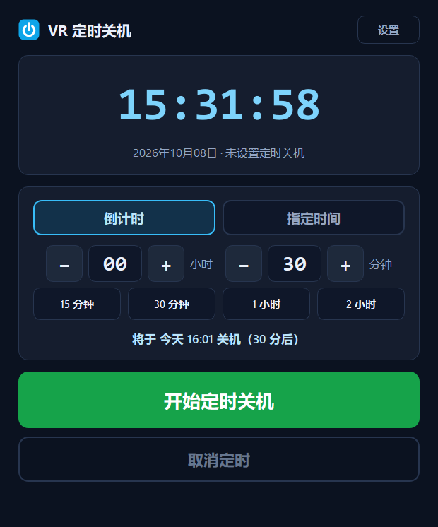
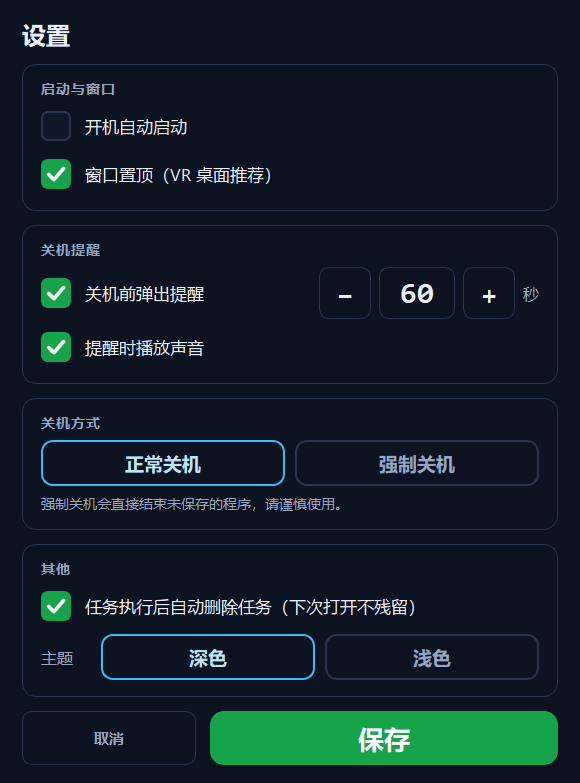
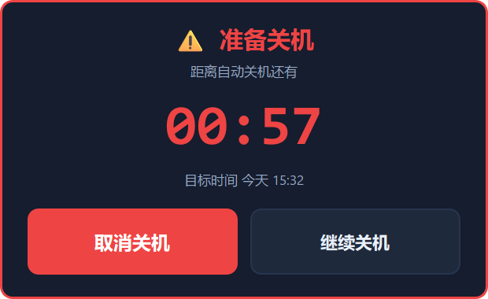

# VR 定时关机 (VR Shutdown Timer)

面向 VR 玩家的 Windows 桌面**单次定时关机**小工具。程序常驻系统托盘，  
用 PySide6 编写，可以打包成**安装包**、**单文件 exe** 或**免安装便携目录**。

界面按 VR 环境（SteamVR 桌面视图 + 手柄射线/鼠标）重新设计：**大字号、大按钮、  
深色高对比主题、极简布局**，主界面只保留倒计时、时间设置和两个主按钮。



---

## 功能

### 主界面（极简）

- **醒目大字倒计时**：任务运行时显示剩余 `HH:MM:SS`（绿色），空闲时显示当前时间（青色）。
- 两种设定方式，一键切换：
  - **倒计时**：`[−] 00 [+] 小时` / `[−] 30 [+] 分钟`，另有 `15 分钟 / 30 分钟 / 1 小时 / 2 小时` 快捷键。
  - **指定时间**：`[−] 23 [+] 时` / `[−] 00 [+] 分`；若该时刻已过，自动顺延到**明天**同一时间（界面有明确提示）。
- 「开始定时关机」大按钮（绿色）、「取消定时」大按钮（红色描边）。
- 右上角一个小的「设置」按钮。
- 主界面**不含**日志、历史、多余选项。

### 设置窗口（高级选项）

| 选项          | 说明                                                       |
| ----------- | -------------------------------------------------------- |
| 开机自动启动      | 写入 `HKCU\...\CurrentVersion\Run`，不自建计划任务；若程序被移动过会自愈为当前路径 |
| 窗口置顶        | 方便 VR 桌面视图操作                                             |
| 关机前弹出提醒     | 可设定提前 N 秒（5–600，步进 5）                                    |
| 提醒时播放声音     | 三声蜂鸣（后台线程，不卡界面）                                          |
| 关机方式        | 正常关机 / 强制关机（`/f`）                                        |
| 发出指令后的宽限时间  | 1–60 秒，给你最后一次反悔的机会                                       |
| 任务执行后自动删除任务 | 勾选后关机完成即清空设定；不勾选则保留上次设定方便复用                              |
| 主题          | 深色（默认）/ 浅色                                               |



### 关机前提醒

到点前弹出**置顶大字提醒窗**（可拖动、按钮 84px 高），显示剩余秒数与目标时间，  
可直接点「取消关机」。同时播放提示音并发系统托盘通知。



### 后台运行

- 点窗口关闭按钮 **不退出**，而是最小化到系统托盘（首次会气泡提示）。
- 托盘图标常驻，计时继续；悬停显示剩余时间。
- **双击**托盘图标恢复主窗口。
- 右键菜单：显示主界面 / 取消定时关机 / 退出程序。
- **单实例**：重复双击 exe 不会开第二个进程，而是把已有窗口唤到前台。
- 关机指令发出后程序**继续留在托盘**，直到系统真正关机前你都能点「取消定时关机」撤回。
- 退出时若有进行中的任务会二次确认。

---

## 安装

### 方式一：安装包（推荐）

下载 `VRShutdownTimer-Setup-<版本>.exe`，双击运行。这是 **NSIS** 做的标准 Windows  
安装向导（Steam 的安装器也是 NSIS）：欢迎页 → 许可协议 → 选择组件 → 选择目录 →  
进度条 → 完成页，可直接勾选「立即运行」。

- 默认装到 `%LOCALAPPDATA%\Programs\VRShutdownTimer`，也可以自己选目录；
- 可选**桌面快捷方式**和**开始菜单项**；
- 自动在 Windows「应用和功能」里登记卸载项；
- **全程不需要管理员权限，不弹 UAC**（只写 HKCU 和当前用户目录）。

静默安装（适合脚本 / 批量部署）：

```bat
VRShutdownTimer-Setup-1.2.0.exe /S
VRShutdownTimer-Setup-1.2.0.exe /S /D="D:\Tools\VRShutdownTimer"
```

| 参数        | 含义                                                  |
| --------- | --------------------------------------------------- |
| `/S`      | 静默安装，不显示界面（组件全选，即含桌面与开始菜单快捷方式）                      |
| `/D=<目录>` | 指定安装目录。必须是**最后一个参数**，且**不要加引号**（路径含空格时也由 NSIS 自己处理） |

### 方式二：便携目录版（免安装）

解压 `dist_portable\VRShutdownTimer\` 整个文件夹，双击里面的 `VRShutdownTimer.exe`。  
不做任何自解压、不写注册表（除开机自启开关外），拷到哪都能跑，  
适合受限环境（企业策略 / 杀软受控文件夹访问 / 沙箱）。

### 方式三：单文件 exe

双击 `dist\VRShutdownTimer.exe` 即可。启动时会把内容自解压到 `%TEMP%`，  
个别受限环境会看到 `Could not create temporary directory!`——此时改用便携目录版或安装包。

### 卸载

- Windows「设置 → 应用 → 已安装的应用」→ VR 定时关机 → 卸载；
- 开始菜单 → `VR 定时关机` → **卸载 VR 定时关机**；
- 或者直接运行安装目录里的 `uninstall.exe`。

卸载会询问是否保留配置（`%APPDATA%\VRShutdownTimer`）。  
静默卸载：`uninstall.exe /S`（默认**保留**配置；交互式卸载时选「否」即一并删除）。

---

## 关机实现

- 计时完全由程序自身完成（`QTimer` 每 200ms 比对**绝对时间戳**，不会累加漂移）。
- 到点优先调用系统自带的 `shutdown.exe`（用 `%SystemRoot%\System32` 下的**绝对路径**，  
  避免 PATH 被劫持或损坏）：
  ```
  正常关机：shutdown /s /t <宽限秒数> /c "VR Shutdown Timer"
  强制关机：shutdown /s /f /t <宽限秒数> /c "VR Shutdown Timer"
  ```
- **真实返回码判定**：`0` 和 `1190`（"已有排队的关机"）都算成功；其余才是失败。  
  只有失败时才升级处理，并在界面上**明确告知**。
- **抗"程序阻止关机"**：正常关机遇阻时自动带 `/f` 重试一次；  
  由于这是用户没选的强制行为，程序会弹通知说明"已升级为强制关机"。
- **兜底不突兀**：`shutdown.exe` 完全不可用时退回系统 API  
  `InitiateSystemShutdownExW`（先启用 `SeShutdownPrivilege`），  
  并把宽限时间作为系统倒计时传进去——**兜底路径同样可以取消**。
- **不依赖任务计划程序**，不注册任何计划任务。
- 取消 = 程序自身取消计时 + 必要时执行 `shutdown /a` 撤回系统队列。

---

## 从源码运行

```powershell
python -m pip install -r requirements.txt
python main.py
```

## 打包

```powershell
python -m pip install -r requirements-dev.txt

powershell -ExecutionPolicy Bypass -File build.ps1              # 单文件 exe
powershell -ExecutionPolicy Bypass -File build.ps1 -Portable    # 便携目录版
powershell -ExecutionPolicy Bypass -File build.ps1 -Installer   # 便携版 + 安装包
powershell -ExecutionPolicy Bypass -File build.ps1 -All -Installer -Clean   # 全都要
```

或双击 `build.bat`（`build.bat installer`、`build.bat all`）。

产物：

| 产物                                              | 说明                  |
| ----------------------------------------------- | ------------------- |
| `dist\VRShutdownTimer.exe`                      | 单文件版                |
| `dist_portable\VRShutdownTimer\`                | 便携目录版（不依赖 `%TEMP%`） |
| `dist_installer\VRShutdownTimer-Setup-<版本>.exe` | 安装包（标准向导 + 卸载）      |
| `dist_installer\VRShutdownTimer-Uninstall.exe`  | 独立卸载器（安装器会把它放进安装目录） |

> **务必用 `.spec` 文件打包。** 如果执行 `pyinstaller --name VRShutdownTimer main.py`，  
> PyInstaller 会自动生成同名 spec **覆盖仓库里的 spec**，并悄悄变成 onedir 模式。  
> `build.ps1` / `build.bat` 已经固定使用 spec，不会踩这个坑。

### 打安装包需要 NSIS

安装包用 [NSIS](https://nsis.sourceforge.io/Download) 生成。装好 NSIS 后  
`makensis.exe` 会在 `PATH` 里，或手动指定：

```powershell
$env:MAKENSIS = "C:\Program Files (x86)\NSIS\makensis.exe"
python installer\build_installer.py
```

`installer/build_installer.py` 的查找顺序是 `MAKENSIS` 环境变量 → `PATH` →  
常见安装位置。

### 打包时踩过的三个坑（都写在脚本注释里了）

1. **`.nsi` 必须存成 UTF-8 with BOM**，否则 makensis 遇到中文直接报  
   `Bad text encoding` 并拒绝编译。
2. **不要调大 LZMA 字典**（`SetCompressorDictSize 64` 之类）。NSIS 解压器会在  
   安装器启动时按字典大小一次性申请内存，字典一大，在内存受限 / 被作业对象  
   限制的环境里会分配失败——表现为双击后**瞬间退出、退出码 2、没有任何提示**。  
   实测 8MB（默认）与 64MB 的产物体积只差 0.8MB，不值得冒险。
3. **不要在安装脚本里用 `nsExec` 插件**。NSIS 会把插件 DLL 释放到 `%TEMP%`  
   再加载；临时目录被重定向或加固时这一步会失败，同样是"瞬间退出、无提示"。  
   用核心指令 `ExecWait` 调 `taskkill` 即可，代价只是窗口闪一下。

> 另外，PyInstaller 的单文件 exe 与 NSIS 安装器都会在 `%TEMP%` 下创建自己的工作  
> 目录。如果某个环境（企业策略、杀软的受控文件夹访问、沙箱类隔离）禁止这个动作，  
> 两者都会启动失败——这时请用**便携目录版**，它不做任何自解压。

---

## 配置与数据

| 内容       | 位置                                                                         |
| -------- | -------------------------------------------------------------------------- |
| 配置文件     | `%APPDATA%\VRShutdownTimer\config.json`                                    |
| 运行日志     | `%APPDATA%\VRShutdownTimer\startup.log`（超过 256 KB 自动轮转为 `.log.1`）          |
| 复选框对勾图   | `%APPDATA%\VRShutdownTimer\assets\check_*.png`（首次运行自动生成）                   |
| 开机自启注册表项 | `HKCU\Software\Microsoft\Windows\CurrentVersion\Run` → `VRShutdownTimer`   |
| 安装位置记录   | `HKCU\Software\VRShutdownTimer` → `InstallDir`                             |
| 卸载信息注册表项 | `HKCU\Software\Microsoft\Windows\CurrentVersion\Uninstall\VRShutdownTimer` |

配置写入采用「临时文件 + 原子替换」，避免断电/崩溃导致配置损坏；  
目录不可写时会依次回退到「用户主目录」「临时目录」，程序不会因此崩溃，  
写失败也会记进 `startup.log`（不会静默丢失设置）。

`config.json` 主要字段：

```jsonc
{
  "theme": "dark",              // dark | light
  "always_on_top": true,
  "autostart": false,
  "reminder_enabled": true,
  "reminder_seconds": 60,       // 关机前 N 秒提醒（5–600）
  "sound_enabled": true,
  "force_shutdown": false,      // false=正常关机 true=强制关机
  "auto_delete_task": true,     // 任务执行后自动删除
  "grace_seconds": 3,           // 发出指令后的宽限秒数（1–60）
  "last_mode": "countdown",     // countdown | clock
  "last_countdown_minutes": 30,
  "last_clock_hour": 23,
  "last_clock_minute": 0,
  "pending_task": null          // 进行中的任务，用于异常退出后恢复
}
```

**异常恢复**：任务进行中会把目标时间写入 `pending_task`。若程序崩溃后重启，  
剩余时间大于 3 秒会自动恢复任务；已过期则清除并提示，不会突然关机。

---

## 项目结构

```
vr-shutdown-timer/
├─ main.py                    # 入口：单实例检测、DPI、启动控制器
├─ vrshutdown/
│  ├─ app.py                  # 控制器：串起配置/调度器/窗口/托盘/提醒
│  ├─ scheduler.py            # 定时调度（绝对时间戳 + 提醒阈值）
│  ├─ main_window.py          # 主界面
│  ├─ settings_dialog.py      # 设置窗口（内容过高时自动滚动，不裁切）
│  ├─ reminder_dialog.py      # 关机前提醒弹窗
│  ├─ widgets.py              # Stepper 大按钮步进器
│  ├─ theme.py                # 深/浅色 QSS
│  ├─ config.py               # 配置读写与校验
│  ├─ platform_win.py         # 关机、取消、自启、提示音、单实例
│  ├─ diag.py                 # 诊断日志（带大小轮转）
│  ├─ icon.py                 # 电源图标（QPainter 现画，无需图片资源）
│  └─ util.py                 # 时间格式化
├─ installer/                 # 安装包（NSIS）
│  ├─ VRShutdownTimer.nsi           # 安装向导
│  ├─ VRShutdownTimer-Uninstall.nsi # 独立卸载器
│  └─ build_installer.py            # 查找 makensis 并编译
├─ tools/
│  ├─ make_icon.py            # 生成 assets/app.ico（仅依赖 PySide6，手工打包 ICO）
│  ├─ make_version_info.py    # 由 APP_VERSION 生成 exe 版本资源
│  └─ screenshot.py           # 渲染各界面 PNG，检查排版
├─ tests/
│  ├─ test_core.py            # 核心逻辑自测（52 项，含关机返回码分支）
│  └─ test_flow.py            # 端到端流程自测（23 项，dry-run，绝不关机）
├─ VRShutdownTimer.spec           # 单文件配置
├─ VRShutdownTimer-portable.spec  # 便携目录配置
├─ build.ps1 / build.bat          # 打包脚本
└─ screenshots/                   # 排版检查用截图
```

---

## 自测与排版检查

```powershell
python tests/test_core.py        # 52 项：时间格式、配置校验、自启、调度、关机返回码分支
python tests/test_flow.py        # 23 项：提醒弹窗、取消、到点执行、自动删除、时钟模式
python tools/screenshot.py       # 输出 screenshots/*.png（深色 + 浅色）
```

`test_core.py` 用桩函数替换真实的 `_run` 与关机 API，`test_flow.py` 走  
`VRSHUTDOWN_DRY_RUN=1`，**两个测试都不会触发真实关机**。

### 开发用安全开关

设置环境变量 `VRSHUTDOWN_DRY_RUN=1` 后，程序只会打印将要执行的关机命令而不会真的关机，  
方便调试完整流程：

```powershell
$env:VRSHUTDOWN_DRY_RUN = "1"
python main.py
```

---

## 注意事项

- 关机需要当前用户有 `SeShutdownPrivilege`（普通用户默认有）；若被安全软件拦截，  
  程序会明确提示「关机指令发送失败」。
- 「任务执行后自动删除任务」勾选时，关机完成后设定会回到默认（30 分钟）；  
  不勾选则保留上次的小时/分钟或目标时刻，方便下次一键复用。
- 界面字号与按钮尺寸按 VR 观看距离放大，窗口使用固定尺寸以避免任何排版错乱。
- 程序本身不会阻止系统休眠；若机器在倒计时期间休眠，唤醒后会立即补执行关机。

### 常见问题

**Q：设了时间，到点却没关机？**  
A：多数是安全软件（如卡巴斯基）拦了关机命令。设置里改用「强制关机」再试，  
或把安装目录加入杀软白名单。也可以看 `%APPDATA%\VRShutdownTimer\startup.log`。

**Q：双击安装包没反应 / 一闪而过？**  
A：先看 `%TEMP%` 下有没有 `VRShutdownTimer-Setup` 相关残留。如果某个安全策略  
禁止程序在临时目录创建工作目录，NSIS 和 PyInstaller 单文件版都会启动失败——  
改用**便携目录版**即可。

**Q：怎么彻底清理？**  
A：先卸载（卸载时选择不保留设置），再手动删掉 `%APPDATA%\VRShutdownTimer`。

---

## 更新日志

### 1.2.0 — 正式安装包 + 一轮安全审计

1. **新增标准 Windows 安装包**：NSIS 制作的安装向导（欢迎页 / 许可 / 组件 / 目录 /  
   进度 / 完成），支持 `/S` 静默安装与 `/D=` 指定目录；自动创建桌面与开始菜单  
   快捷方式、登记「应用和功能」卸载项；自带 100 KB 的独立卸载器；  
   全程当前用户级，不需要管理员权限。
2. **exe 补齐版本资源**：文件属性里终于有产品名与版本号（`version_info.txt`），  
   便于排查问题与安全软件建立信誉；仓库补上 `LICENSE`（MIT）。
3. **兜底关机不再"跳过宽限时间"**：旧版最后兜底调用 `ExitWindowsEx`，会**立即强制关机**，  
   既不遵守你设的宽限秒数、也没有任何取消机会；现在改用 `InitiateSystemShutdownExW`，  
   把宽限时间交给系统倒计时，兜底路径依然能用「取消定时」撤回。
4. **强制升级会明说**：正常关机被程序阻止时会自动 `/f` 重试（1.1.0 的核心修复），  
   但这属于用户没选的强制行为——现在会弹通知告知「已升级为强制关机」。
5. **`shutdown` 返回码 1190 视为成功**：系统里已经有一个排队的关机时，  
   旧代码判定为失败并继续重试/兜底，反而会立刻强制关机；现在正确识别为"目标已达成"。
6. **取消窗口不再被自己关掉**：发出关机指令后程序不再 1.2 秒就退出，  
   而是留在托盘里，托盘「取消定时关机」在系统倒计时期间始终可用。
7. **修掉无托盘时的僵尸进程**：托盘不可用时关闭窗口，进程和计时器会永远留在后台且无法唤回；  
   现在会真正退出。
8. **配置范围与界面一致**：`grace_seconds` 旧版界面允许 60 秒、存盘却被夹到 30；  
   `reminder_seconds` 上限两边不一致——都会静默改掉用户设置，现已对齐。
9. **开机自启自愈**：自启项改为与当前程序路径比对，程序被移动/换安装目录后会自动改写，  
   不再出现"界面显示已开启、开机却没反应"。
10. **诊断日志**：新增 `vrshutdown/diag.py`，统一写 `startup.log` 并自动轮转；  
    配置写失败、命令启动失败、API 兜底失败都会留痕，而不是被 `except: pass` 吞掉。
11. **单实例细节**：互斥体在启动失败路径上会被正确释放（否则之后所有启动都"没反应"）；  
    唤醒已有窗口时不再用子串匹配标题，避免把消息投给无关窗口。
12. **子进程超时会清理**：`shutdown.exe` 挂起时不再留下孤儿进程。

### 1.1.0 — 修复「不能正常定时关机」

1. **关机结果不再误报**：旧版执行 `shutdown.exe` 后不检查返回码，无论成败都提示「已发出」。  
   现在会同步等待并读取真实返回码，失败会明确弹窗告知原因。
2. **抗「程序阻止关机」**：正常关机被系统挡住时（未保存文档、SteamVR/VRChat 等），  
   自动带 `/f` 重试一次。
3. **可调宽限时间**：设置里新增「发出指令后的宽限时间」（1–60 秒）。
4. **Stepper 不再误跳**：时长步进器到边界时钳制而非回绕。
5. **单实例唤醒更可靠**：改用枚举顶层窗口 + 模糊标题匹配。
6. **提醒弹窗出现在你面前**：优先显示在鼠标所在屏幕（VR/多屏环境），并强制置顶。
7. **旧配置自动清理**：`config.json` 里历史遗留字段会被自动移除并补全缺失项。

---

## 许可

[MIT](LICENSE)
